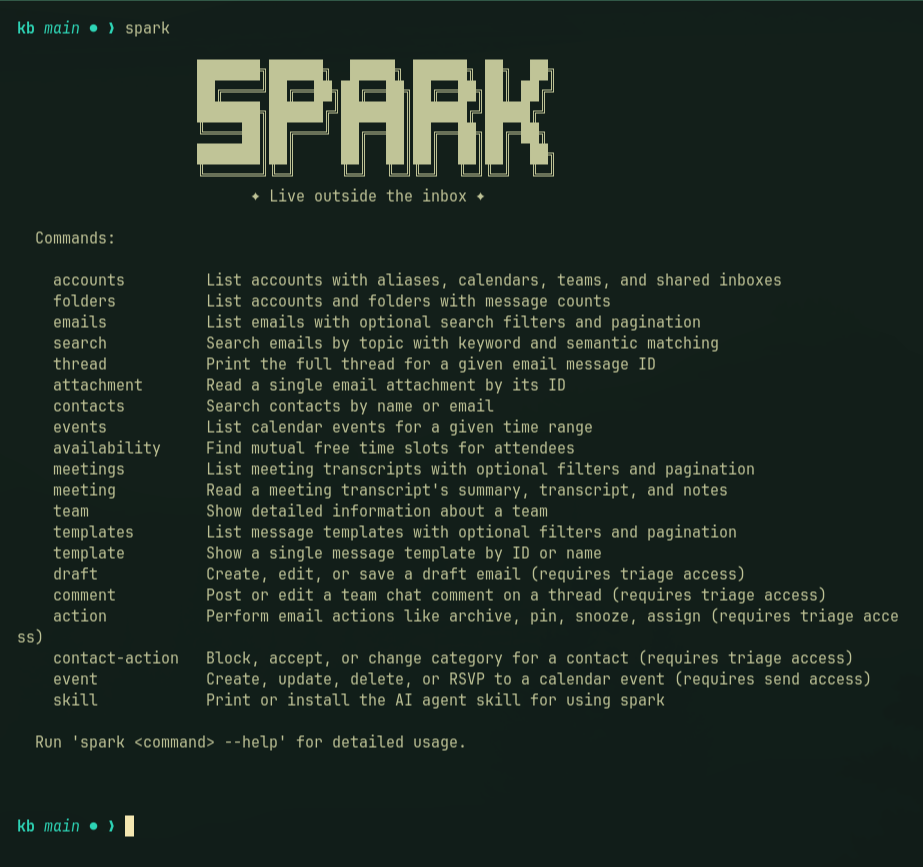
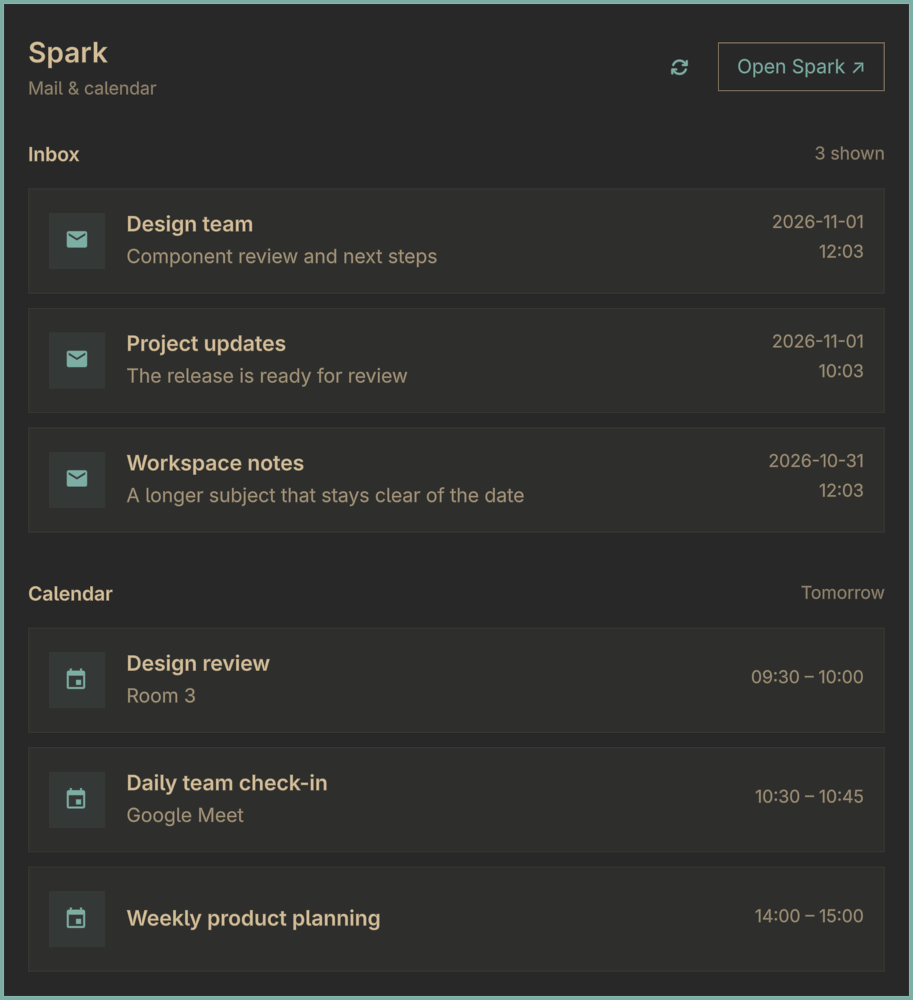
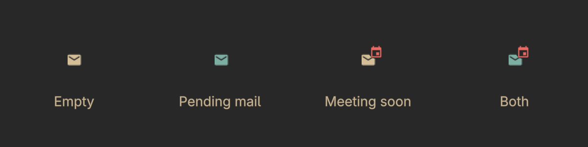

# spark-mail-linux

Run [Spark Mail](https://sparkmailapp.com/) for Windows on Linux with Wine.
Two DLL shims prevent known crashes. Scripts handle launch, browser login, and native notifications.

This project is unofficial. Readdle does not support it.

**Verified:** Spark 3.32.3.141489 starts on Arch Linux with Wine 11.16.


## Install

Run these steps from the repository root on Arch Linux:

1. Download the official Windows `Spark.exe`. Follow [the installation guide](INSTALLATION.md#2-get-the-installer) to check the release and installer URL.
2. Run `./install.sh /path/to/Spark.exe`.
3. Launch Spark with `./run-spark.sh`. Use this command for later launches too.

The installer adds a desktop launcher and registers browser callbacks, deep links, and `mailto:` links.
The application, Wine prefix, and account state stay in this directory.

See [INSTALLATION.md](INSTALLATION.md) for dependencies, setup options, and troubleshooting.

## What works

Spark 3.32.3.141489 runs and loads SparkCore.
Mail, calendar, attachments, and notification delivery still need checks on this version.

Spark 3.30.10 and 3.30.11 passed checks for login, inbox, calendar, mail delivery, attachments, and notifications.
Separate checks confirm host links, clipboard text, image paste, and DOCX, XLSX, and CSV attachments in drafts.

## Spark CLI



Start Spark Desktop. In **Settings > AI Agents**, permit access to the accounts you need.
Then run:

```bash
./bin/spark --help
./bin/spark --version
./bin/spark accounts
```

The wrapper reuses the desktop's Wine environment. Spark Desktop must remain open.

Read-only account, folder, and email commands passed checks on earlier versions.
Triage and send operations remain unverified.

To add `spark` to your PATH, run these commands from the repository root:

```bash
mkdir -p ~/.local/bin
ln -s "$PWD/bin/spark" ~/.local/bin/spark
```

Ensure `~/.local/bin` is on your PATH. The command refuses to replace an existing file.
See [CLI maintenance](AGENTS.md#spark-cli) for agent skills and update checks.

## Omarchy plugin

The optional plugin shows the unified inbox and calendar in the Omarchy bar.
Click an email to open its thread. Click an event to open Spark's calendar.

The mail icon shows pending emails. A calendar badge appears 15 minutes before an event.





The plugin requires Omarchy, Hyprland, and Spark Desktop with CLI read access.
Run the installer from the repository root:

```bash
./integrations/omarchy/install.sh
```

See [the plugin guide](integrations/omarchy/README.md) for settings, checks, and screenshots with sample data.

## Update

Use the repository updater. Spark's internal update button bypasses the compatibility patches and backups.

```bash
./update-spark.sh
```

To check without changes, run `./update-spark.sh --check`.
You can also click the refresh icon beside **Open Spark** in the Omarchy popup.
If Spark is current, the updater exits without a restart.

The updater prepares and validates the new application before it stops Spark.
It backs up the current installation under `archive/`, replaces the application, and restarts Spark.
It preserves the Wine prefix and runtime.

Checks cover the version, visible window, SparkCore, CLI help, and CLI version.
The updater also attempts a read-only account query. These checks do not verify mail or calendar operations.

If startup fails, inspect the saved logs before recovery. The updater never restores older mailbox state automatically.

After successful checks, the updater keeps the newest backup and the newest update directory.
Set `SPARK_KEEP_BACKUPS` in `spark.local.env` to keep more.
The updater requires the repository installation, a user systemd session, and Hyprland.
For custom application or prefix paths, use [the manual update and rollback procedure](AGENTS.md#update-spark).

## Limits

- Bubblewrap contains filesystem writes but retains network and display access. It is not a security sandbox.
- File dialogs use Wine's interface. Files copied from the host file manager can be inaccessible inside Bubblewrap.
- Image paste requires the optional helper on Hyprland. See [the image paste notes](docs/investigation.md#image-paste).
- Native notifications depend on Spark's database format. Spark updates can break them.

## Development

Read [AGENTS.md](AGENTS.md) for project rules and maintenance procedures.
See [the investigation](docs/investigation.md) for Wine failures and compatibility fixes.

Enable the commit guard:

```bash
git config core.hooksPath .githooks
```

Never commit application binaries, mailbox data, credentials, or logs.

## License

The project scripts use the [MIT license](LICENSE).

Spark belongs to Readdle. Download Spark from Readdle and follow their terms.
This repository contains no Spark or Microsoft code.
